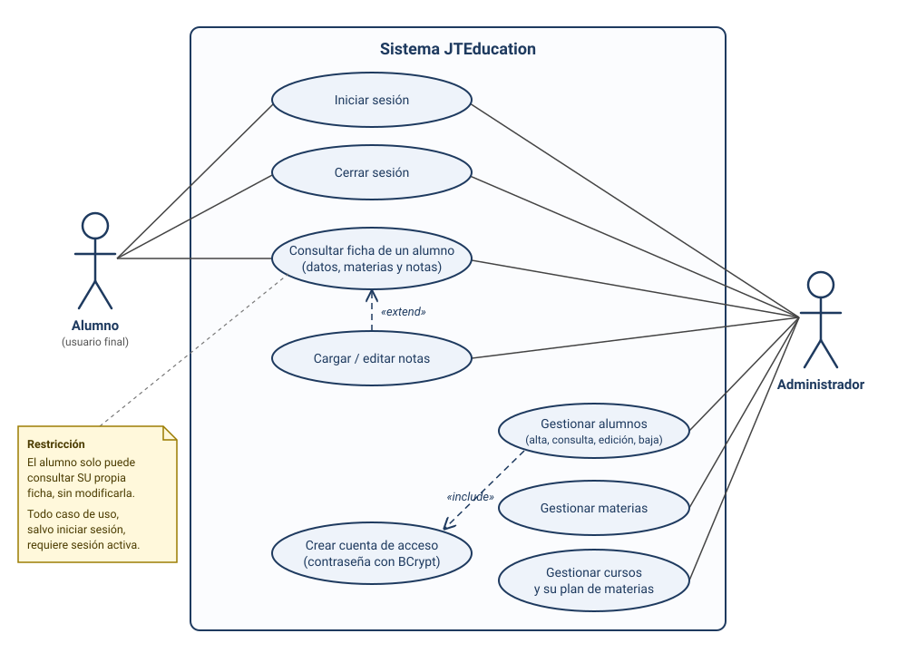

# Casos de uso

Qué puede hacer cada tipo de usuario en JTEducation, y cómo se controla en el código.

## Diagrama UML de casos de uso

**Cómo se lee:**
- Los **actores** (muñecos) son los tipos de usuario. Están fuera del rectángulo porque no forman parte del sistema: lo usan.
- Cada **óvalo** es un caso de uso: algo que el usuario logra hacer con el sistema.
- Una **línea continua** une un actor con un caso de uso que puede realizar.
- **«include»** (flecha punteada): el caso de uso de origen *siempre* incluye al de destino. Dar de alta un alumno siempre crea su cuenta de acceso.
- **«extend»** (flecha punteada): el caso de uso de origen agrega un comportamiento *opcional* al de destino. Desde la ficha de un alumno, el administrador puede, si quiere, cargar o editar las notas de una materia.

## Actores

| Actor | Rol en el sistema (`entity/Rol`) | Descripción |
|---|---|---|
| **Administrador** | `ADMIN` | Personal de la escuela. Gestiona toda la información académica. |
| **Alumno** (usuario final) | `ALUMNO` | Estudiante inscripto. Solo consulta su propia información. |

Los dos inician sesión con su **email** y su **contraseña**. La cuenta del administrador viene en los datos de prueba; la cuenta de cada alumno la crea el administrador al darlo de alta.

## Casos de uso y permisos

| Caso de uso | Administrador | Alumno | Rutas |
|---|:---:|:---:|---|
| Iniciar sesión | ✅ | ✅ | `GET /login`, `POST /login` |
| Cerrar sesión | ✅ | ✅ | `POST /logout` |
| Consultar ficha de un alumno (datos, materias y notas) | ✅ cualquier alumno | ✅ **solo la propia** | `GET /alumnos/{id}` |
| Cargar / editar notas | ✅ | ❌ | `GET` y `POST /alumnos/{id}/notas/{idMateria}` |
| Gestionar alumnos (alta, listado, edición, baja) | ✅ | ❌ | `/alumnos`, `/alumnos/nuevo`, `/alumnos/{id}/editar`, `/alumnos/{id}/eliminar` |
| Crear cuenta de acceso (incluido en el alta de alumno) | ✅ | ❌ | `POST /alumnos` |
| Gestionar materias | ✅ | ❌ | `/materias/**` |
| Gestionar cursos y su plan de materias | ✅ | ❌ | `/cursos/**` |
| Ver el inicio con los últimos alumnos inscriptos | ✅ | ❌ (va directo a su ficha) | `GET /` |

### Descripción de cada caso de uso

1. **Iniciar sesión.** El usuario escribe su email y su contraseña. Spring Security busca la cuenta (`UsuarioDetailsService`) y compara la contraseña con el hash guardado usando BCrypt. Si coinciden, crea la sesión y lleva al administrador al inicio y al alumno a su ficha. Si no, vuelve al login con el mensaje "Email o contraseña incorrectos." (no dice cuál de los dos falló, para no revelar qué emails existen).
2. **Cerrar sesión.** Botón "Cerrar sesión" del encabezado (`POST /logout`). Invalida la sesión, borra la cookie `JSESSIONID` y vuelve al login. La sesión también se cierra sola después de 30 minutos sin actividad.
3. **Consultar ficha de un alumno.** Muestra los datos personales, el domicilio, el email y la tabla con las materias del plan de su curso y sus notas. El administrador puede ver cualquier ficha; el alumno solo la suya. Si un alumno escribe en la URL el id de otro, recibe la página **403 "Acceso denegado"**.
4. **Cargar / editar notas** (extiende al caso 3). Desde la ficha, el administrador carga la 1° nota, la 2° nota y la nota final de una materia (entre 1 y 10). Si deja las tres vacías, se borran.
5. **Gestionar alumnos.** Alta, listado paginado, edición y baja. No se puede cambiar de curso ni eliminar a un alumno que ya tiene notas.
6. **Crear cuenta de acceso** (incluido en el alta de alumno). Crea el usuario con rol `ALUMNO` y guarda la contraseña hasheada con BCrypt, nunca en texto plano.
7. **Gestionar materias.** Alta, listado, edición y baja. No se repiten nombres, y no se puede eliminar una materia asignada a un curso o con notas.
8. **Gestionar cursos y su plan de materias.** Alta, listado, detalle, edición y baja. No se repite año + división + ciclo lectivo, no se puede quitar del plan una materia con notas, y no se puede eliminar un curso con alumnos.

## Dónde se controlan los permisos

Los permisos se controlan **en el servidor**, no solo ocultando botones:

1. **`config/SeguridadConfig.java`**: es la regla principal. Cada petición pasa por los filtros de Spring Security antes de llegar al controlador:
   - Sin sesión, cualquier página redirige a `/login`.
   - `GET /alumnos/{id}`: el administrador pasa siempre; el alumno, solo si el `{id}` es el de su propia ficha.
   - Todo lo demás de gestión exige el rol `ADMIN`. Si un alumno lo intenta, recibe un error **403**.
2. **Las vistas** (`sec:authorize` de Thymeleaf) muestran u ocultan el menú y los botones según el rol. Es solo para que la interfaz sea clara: aunque alguien escriba una URL a mano, la regla del punto 1 lo frena igual.

## Usuarios de prueba

| Rol | Email | Contraseña |
|---|---|---|
| Administrador | `admin@jteducation.com` | `Admin1234` |
| Alumno | el email de cualquier alumno de `bbd/datos_prueba.sql` (por ejemplo `lucia.fernandez@mail.com`) | `Alumno1234` |
